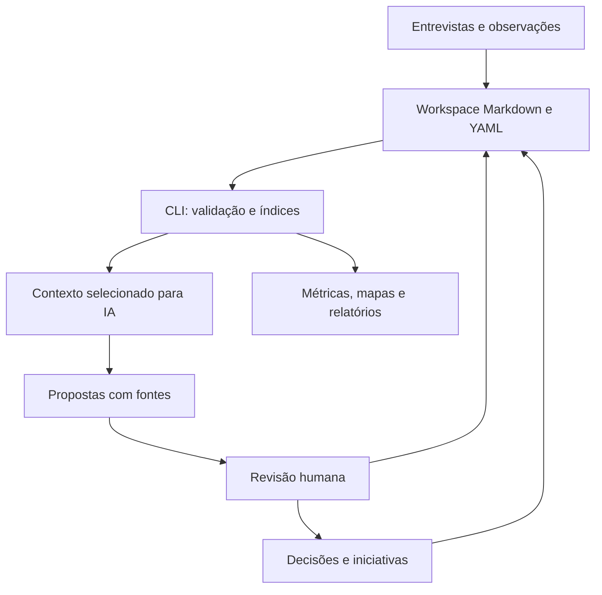

# Arquitetura — V1

Documento de orientação. Contratos detalhados estão em [data-contracts.md](data-contracts.md) e em `plano.md`.

## Camadas

| Camada | Responsabilidade | Não deve fazer |
|---|---|---|
| `domain/` | Modelos, enums, invariantes locais, regras de priorização e métricas | Ler arquivos, executar comandos ou chamar modelos |
| `application/` | Casos de uso e validação de relações entre registros | Depender de detalhes do Cursor |
| `infrastructure/` | Leitura/escrita Markdown, renderização, hashes, relógio e configurações | Decidir se uma hipótese é verdadeira |
| `cli/` | Argumentos, mensagens, códigos de saída e composição das dependências | Concentrar regras de negócio |
| `prompts/` e `.cursor/rules/` | Orientar extração, revisão e análise | Substituir validação de código |

Use uma interface pequena `RecordRepository` nas fronteiras de leitura e escrita. Implemente apenas `MarkdownRepository`. Não criar um framework genérico de providers.

## Fluxo lógico

## Portabilidade e privacidade

O domínio não depende de Cursor, GitHub ou fornecedor de modelo. Dados reais ficam fora da árvore publicável. Uma pasta externa não autoriza, por si só, o envio de conteúdo a um provedor de IA.

## Estado da implementação

P0 entrega esta descrição e a estrutura de pastas. Código das camadas entra em P1 em diante. Não tratar diretórios vazios como módulos funcionais.
